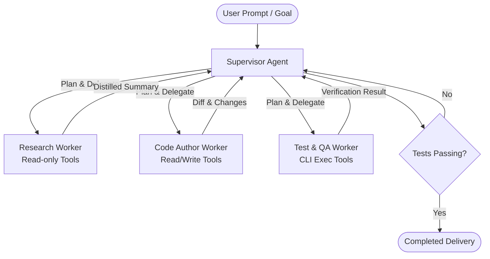
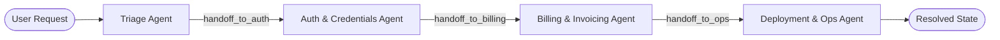
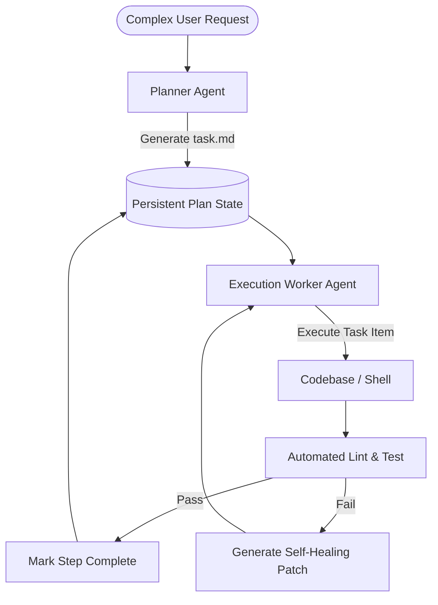
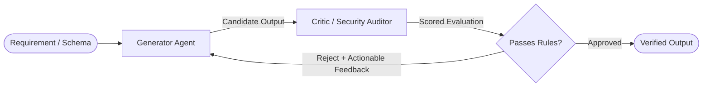

# ⚡ Awesome Agentic Patterns & Production Playbook

[](https://awesome.re)
[](LICENSE)
[](https://github.com/DYNOSuprovo/awesome-agentic-patterns)
[](CONTRIBUTING.md)
[](https://github.com/DYNOSuprovo/awesome-agentic-patterns)

> A curated collection of battle-tested **AI Agent architectures, Model Context Protocol (MCP) servers, system prompt blueprints, context window optimization strategies, failure-mode guardrails, and production rule templates** for software engineering teams.

---

## 📑 Table of Contents

- [🏛️ Architectural Patterns](#️-architectural-patterns)
  - [1. Supervisor / Hierarchical Delegation](#1-supervisor--hierarchical-delegation)
  - [2. Peer-to-Peer Swarm / Handoff](#2-peer-to-peer-swarm--handoff)
  - [3. Plan-and-Execute (Planner + Workers)](#3-plan-and-execute-planner--workers)
  - [4. Reflection & Evaluator-Optimizer](#4-reflection--evaluator-optimizer)
- [⚖️ Agent Framework Decision Matrix](#️-agent-framework-decision-matrix)
- [🛡️ Production Failure Modes & Defense Matrix](#️-production-failure-modes--defense-matrix)
- [🔌 Curated Model Context Protocol (MCP) Directory](#-curated-model-context-protocol-mcp-directory)
- [🛠️ Ready-to-Use Agent Configuration Blueprints](#️-ready-to-use-agent-configuration-blueprints)
  - [Cursor (`.cursorrules`)](#cursor-cursorrules)
  - [Claude Code (`CLAUDE.md`)](#claude-code-claudemd)
  - [Google Antigravity (`AGENTS.md`)](#google-antigravity-agentsmd)
  - [Windsurf (`.windsurfrules`)](#windsurf-windsurfrules)
- [📊 Context Window & Token Economics](#-context-window--token-economics)
- [💻 Minimal Executable Implementations](#-minimal-executable-implementations)
- [🚀 Interactive Setup CLI](#-interactive-setup-cli)
- [⭐ Star History](#-star-history)
- [🤝 Contributing](#-contributing)
- [📄 License](#-license)

---

## 🏛️ Architectural Patterns

### 1. Supervisor / Hierarchical Delegation



* **When to use:** Complex workflows where a primary coordinator decomposes tasks and delegates to specialized subagents with isolated context windows.
* **Benefits:** Eliminates context window saturation. The root coordinator receives only distilled summaries, while subagents handle noisy intermediate output (e.g., grepping 100 files, parsing build logs).
* **Reference Template:** [`templates/antigravity/AGENTS.md`](templates/antigravity/AGENTS.md)

---

### 2. Peer-to-Peer Swarm / Handoff



* **When to use:** Multi-domain customer workflows or stateful handoffs where tasks shift dynamically between specialized personas without a central choke point.
* **Benefits:** Decentralized control; state is transferred cleanly through structured function calling (`transfer_to_<agent>()`).

---

### 3. Plan-and-Execute (Planner + Workers)



* **When to use:** Multi-file refactors, large framework migrations (e.g. Next.js 13 to 15, Vue 2 to 3), or long-running autonomy tasks.
* **Benefits:** Deterministic accountability, resume-on-failure capabilities, and live visibility into task progress.

---

### 4. Reflection & Evaluator-Optimizer



* **When to use:** Generating mission-critical code, database security rules (Firestore/Supabase RLS), regex parsers, and financial ledger logic.
* **Benefits:** Drastically reduces hallucinations and edge-case errors before user review.

---

## ⚖️ Agent Framework Decision Matrix

| Framework | Primary Pattern | State Management | Human-in-the-Loop | Best Use Case |
| :--- | :--- | :--- | :--- | :--- |
| **Google Antigravity (AGY)** | Supervisor & Reactive Tasks | Artifacts (`task.md`) + Sandboxes | Built-in Confirmation Gates | Autonomous pair programming & OS automation |
| **LangGraph** | Graph-based Cyclic Workflows | Checkpointer (Postgres/Redis/Memory) | Built-in Breakpoints | Enterprise business logic & conditional graphs |
| **OpenAI Swarm** | Peer-to-Peer Handoff | Ephemeral Stateless Context | Manual Function Routing | Lightweight multi-agent customer support & triage |
| **CrewAI** | Role-Based Hierarchical Teams | Crew Memory (RAG + SQLite) | Delegation Hooks | Content research, SEO, and multi-step reporting |
| **AutoGen** | Conversable Multi-Agent Groups | Chat History Logging | Human Input Mode | Group ideation, research simulations, code math |

---

## 🛡️ Production Failure Modes & Defense Matrix

| Failure Mode | Root Cause | Production Defense Strategy |
| :--- | :--- | :--- |
| **Infinite Tool Loop** | Tool fails, agent retries identical call indefinitely | Enforce a hard cycle detector (max 3 identical calls) and bounded execution timeout budgets. |
| **Context Degradation** | Conversation exceeds 60% window capacity, ignoring earlier rules | Spawn ephemeral subagents for noisy research, compact logs, and persist state in markdown artifacts. |
| **Hallucinated Tool Args** | LLM guesses unsupported parameter names | Enforce strict Pydantic / JSON schemas with `extra='forbid'` and return schema validation errors to the model. |
| **Destructive Command Risk** | Agent attempts broad file deletion or dropping production DB | Intercept dangerous patterns (`DROP TABLE`, `rm -rf`, `gcloud delete`) with mandatory user confirmation gates. |
| **Silent Swarm Deadlock** | Agents hand tasks back and forth endlessly | Add a decrementing `max_hops = 10` counter inside the shared payload; fail when zero. |

---

## 🔌 Curated Model Context Protocol (MCP) Directory

The **Model Context Protocol (MCP)** standardizes how AI agents interface with external data and execution tools:

| MCP Server | Category | Description | Source / Install Command |
| :--- | :--- | :--- | :--- |
| **`mcp-server-filesystem`** | Filesystem | Secure, sandboxed directory reading and editing | `npx -y @modelcontextprotocol/server-filesystem /path` |
| **`mcp-server-git`** | Version Control | Inspect diffs, commits, branches, and git logs | `uvx mcp-server-git` |
| **`mcp-server-postgres`** | Database | Introspect schemas, execute read-only SQL queries | `npx -y @modelcontextprotocol/server-postgres <conn-string>` |
| **`mcp-server-sqlite`** | Database | Local SQLite database schema inspection and queries | `uvx mcp-server-sqlite --db-path <path>` |
| **`mcp-server-github`** | Cloud / DevOps | Manage issues, pull requests, reviews, and CI runs | `npx -y @modelcontextprotocol/server-github` |
| **`mcp-server-puppeteer`** | Web Automation | Headless browser navigation, screenshots, scraping | `npx -y @modelcontextprotocol/server-puppeteer` |
| **`chrome-devtools-mcp`** | DevTools | Web performance, DOM inspection, and console audit | `npx -y @chrome-devtools/mcp-server` |
| **`mcp-server-memory`** | Long-Term Memory | Persistent knowledge graph across chat sessions | `npx -y @modelcontextprotocol/server-memory` |
| **`mcp-server-fetch`** | Web & API | Fetch web content and convert HTML cleanly to Markdown | `uvx mcp-server-fetch` |
| **`mcp-server-docker`** | DevOps | Inspect containers, container logs, and compose setups | `uvx mcp-server-docker` |
| **`mcp-server-sentry`** | Observability | Query crash reports, issue traces, and exception spikes | `uvx mcp-server-sentry` |
| **`mcp-server-slack`** | Messaging | Query channels, post status updates, triage pings | `npx -y @modelcontextprotocol/server-slack` |

---

## 🛠️ Ready-to-Use Agent Configuration Blueprints

### Cursor (`.cursorrules`)
Store in your repository root as `.cursorrules`:
```markdown
# Role & Philosophy
You are an expert senior software engineer. Prioritize clean architecture, strict typing, and zero regressions.

# Coding Guidelines
- Maintain documentation integrity: Never strip existing comments or docstrings.
- Always prefer pure functions and immutable data transformations.
- In TypeScript: Use strict mode, avoid `any`, prefer discriminated unions over enums.
- Always include automated test cases for edge conditions.
- Before declaring done: Run typecheck and unit tests locally.
```

### Claude Code (`CLAUDE.md`)
Store in your repository root as `CLAUDE.md`:
```markdown
# Project Overview
Production service built with TypeScript & Node.js.

# Commands
- Build: `pnpm build`
- Test: `pnpm test`
- Lint: `pnpm lint --fix`

# Architecture Rules
- Controllers handle HTTP routing; services handle business logic; repositories handle data access.
- All database queries must use prepared statements and connection pooling.
- Never write credentials or hardcoded keys into source files.
```

### Google Antigravity (`AGENTS.md`)
Store in your repository root as `AGENTS.md`:
```markdown
# Agent Directives
- Prefer interactive sidecar viewers for visualization tasks.
- Keep context lean: Use subagents for broad codebase research and log scraping.
- Verify every modification with unit tests before declaring completion.
- When creating markdown artifacts, use standard GitHub-Flavored Markdown.
```

### Windsurf (`.windsurfrules`)
Store in your repository root as `.windsurfrules`:
```markdown
# Windsurf AI Directives
- Scan the directory structure before writing new modules.
- Preserve consistent project naming conventions and code style.
- Validate dependencies before introducing third-party packages.
```

---

## 📊 Context Window & Token Economics

Managing context windows is critical for agent reliability and cost efficiency:

1. **The 60% Threshold:** Once an agent's context window exceeds 60% capacity, instruction following accuracy begins to degrade exponentially.
2. **Subagent Ephemeral Offloading:** Delegate noisy operations (e.g., searching 50 files or reviewing 1,000 log lines) to short-lived subagents that return only a 3-sentence summary.
3. **Structured Artifacts:** Persist long-term plans and state in markdown artifacts (`task.md`) rather than keeping the entire conversational history in memory.

---

## 💻 Minimal Executable Implementations

### Python: Lightweight Two-Agent Supervisor
```python
from typing import Literal
from pydantic import BaseModel, Field

class DelegationPlan(BaseModel):
    next_worker: Literal["researcher", "coder", "finish"]
    instruction: str = Field(description="Actionable instruction for the worker")

def supervisor_step(user_goal: str, history: list[str]) -> DelegationPlan:
    # Example supervisor prompt using structured output
    ...
```

---

## 🚀 Interactive Setup CLI

Initialize agent rules and MCP configs for your project in seconds:

```bash
# Clone the repository
git clone https://github.com/DYNOSuprovo/awesome-agentic-patterns.git

# Run the setup wizard
python awesome-agentic-patterns/scripts/setup_agent.py
```

The CLI inspects your workspace, detects whether you use Next.js, Python, Node, Go, or Rust, and generates production-ready `.cursorrules`, `CLAUDE.md`, and `mcp.json` automatically!

---

## ⭐ Star History

[](https://star-history.com/#DYNOSuprovo/awesome-agentic-patterns&Date)

---

## 🤝 Contributing

Contributions are welcomed! Have a new MCP server, production prompt pattern, or architecture diagram?
1. Fork the repo.
2. Create your feature branch (`git checkout -b feature/new-pattern`).
3. Commit your changes (`git commit -m 'Add Multi-Agent Reflection blueprint'`).
4. Push to the branch (`git push origin feature/new-pattern`).
5. Open a Pull Request.

---

## 📄 License

Distributed under the MIT License. See [LICENSE](LICENSE) for more information.
